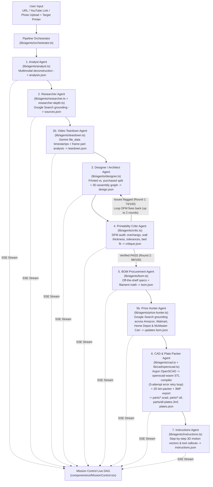

# Get Me An Alt

> **Don't buy it. Get an alt.** Paste a product link, YouTube video, or photo of any overpriced gadget—a coordinated swarm of **Gemini 4 Argon** agents reverse-engineers it into a DIY alternative built from **plate-packed 3D-printed parts + off-the-shelf retail hardware**, complete with a live-priced BOM, compiled OpenSCAD/STL & 3MF print plates, IKEA-style animated 3D assembly instructions, and an interactive exploded CAD view.

Built at the **Gemini 4 Argon SF Hackathon** (Google DeepMind × Cerebral Valley, Oct 25, 2026). See `AGENTS.md` for the build spec, `COORDINATION.md` for lane contracts, and `MESSAGEBOARD.md` for live multi-agent coordination logs.

---

## Live Links

- **Production App:** [https://get-me-an-alt.vercel.app](https://get-me-an-alt.vercel.app)
- **Flagship Instant Demo Project (`plant-auto-waterer`):** [https://get-me-an-alt.vercel.app/projects/plant-auto-waterer](https://get-me-an-alt.vercel.app/projects/plant-auto-waterer)
- **Live Demo Manifest API:** [https://get-me-an-alt.vercel.app/api/objects/demo](https://get-me-an-alt.vercel.app/api/objects/demo)

---

## The Problem: 6× Retail Markup for Injection-Molded Plastic

Consumer hardware gadgets—smart plant waterers, studio art easels, smartphone microscope stages, benchtop lab liquid handlers—routinely retail for **$120 to $600+**, even when their functional core is **$15–$30 of commodity microcontrollers, pumps, sensors, and metric fasteners** wrapped in proprietary injection-molded plastic and a cloud subscription.

Meanwhile, desktop FDM 3D printers (Bambu Lab A1, Prusa MK4S, Creality K1, Voron) can fabricate watertight, structural PETG/PLA+ enclosures overnight for pennies per gram—or on-demand print bureaus (Craftcloud, JLC3DP, Xometry) can ship them for under $15. What stops makers and everyday users from building their own alternative is the **engineering translation bottleneck**: deconstructing the product, sourcing the exact off-the-shelf parts, modeling printable CAD with real tolerances, packing build plates, and writing assembly instructions.

**Get Me An Alt** automates that entire hardware engineering pipeline in one click using managed **Gemini 4 Argon** agents.

### Canonical Flagship Build: HydroPulse Smart Plant Auto-Waterer

| Metric | Commercial Product (*AeroDrop Pro*) | **Get Me An Alt** DIY Build | Delta |
| :--- | :--- | :--- | :--- |
| **Total Cost** | **$149.00** MSRP | **$24.85** (`$21.30` hardware + `$3.55` filament) | **You save $124.15 (83.3%)** |
| **Architecture** | Proprietary ABS shell + cloud lock-in | **11 parts** (7 printed part designs / 8 printed items + 4 purchased hardware modules) | 100% open & serviceable |
| **3D Print Fabrication** | N/A | **1 plate** on Bambu Lab A1 (256×256×256 mm, 64.2% bed utilization, **185g** PETG/PLA+, **3h 24m** / 204 min) | Zero slicer supports required |
| **DFM Verification** | N/A | **2-round Critic → Designer loop** (`74/100` → **98/100** after 4 DFM fixes) | Watertight 3.5mm walls, 0.30mm bayonet clearance |
| **Assembly** | Pre-assembled | **7 animated IKEA-style steps** (~25 min total) | Interactive 3D step player |

---

## Multi-Agent Gemini 4 Argon Architecture (`lib/agents/`)

Every stage in `lib/agents/` is a specialized **Gemini 4 Argon** agent orchestrated by `lib/agents/orchestrator.ts` and executed via `lib/agents/runner.ts`.

- **Dual Execution Runtime (`lib/agents/runner.ts`):** Locally, agents spawn the **Antigravity CLI** (`agy -p "<prompt>" --model gemini-4-argon --output-format json --dangerously-skip-permissions`) and capture conversation IDs, token telemetry, and structured JSON artifacts. On Vercel serverless (or when `inlineData` images / `google_search` grounding tools are active), the runner automatically routes to the **Gemini 4 Argon REST API** (`v1beta/models/gemini-4-argon:generateContent`) with a deterministic engineering fallback so the demo never breaks.
- **Artifact-First Workspace:** Each run writes structured artifacts to `data/objects/<slug>-<id>/` (`analysis.json`, `sources.json`, `teardown.json`, `design.json`, `critique.json`, `bom.json`, `plates.json`, `cad-report.json`, `parts/*.scad`, `parts/*.stl`, `parts/all-plates.3mf`, `instructions.json`) and streams real-time Server-Sent Events (`{ agent, phase: "start" | "thought" | "artifact" | "done" | "error", message, data, ts }`) over `/api/objects/[id]/stream`.



### Inside Each Agent

1. **Analyst (`lib/agents/analyst.ts`)** — Inspects product URLs, descriptions, or uploaded gadget photos (via Gemini multimodal `inlineData`), extracting the commercial MSRP, why it is overpriced, overall bounding dimensions, core mechanisms, and what gets 3D-printed vs. bought (`analysis.json`).
2. **Researcher (`lib/agents/researcher.ts`, `lib/agents/researcher-depth.ts`)** — Uses Gemini 4 Argon with **Google Search grounding** (`tools: [{ google_search: {} }]`) to gather open-source CAD priors (Printables, Thingiverse, GitHub), schematics, PDF datasheets, and teardown references across 7 source categories (`sources.json`). When ungrounded, it transparently labels verified platform search URLs (`groundingUsed: false`).
3. **Video Teardown Agent (`lib/agents/teardown.ts`)** — Passes YouTube teardown/disassembly URLs to Gemini 4 Argon via `file_data` to identify exact timestamps where internal components are visible, captures frames (`yt-dlp` + `ffmpeg` locally or Argon timestamped descriptions + thumbnail fallback on serverless), and extracts per-part dimensions, fasteners, and print-vs-buy classifications (`teardown.json`).
4. **Designer / Architect (`lib/agents/designer.ts`)** — Decomposes the gadget into parametric 3D-printed parts and off-the-shelf components, producing `design.json` with exact `dims_mm`, parametric primitives (`tube`, `cylinder`, `enclosure`, `box`, `cone`, etc.), 3D assembly `position`, `rotation`, and `explode` vectors.
5. **Printability Critic (`lib/agents/critic.ts`)** — Audits every printed part in `design.json` against the selected printer's build volume for **overhang angles (<=45°)**, **structural/watertight wall thickness**, **fastener & bayonet clearances**, and **bed fit**. When Round 1 flags issues, the orchestrator loops actionable fixes back into `runDesignerAgent` for a revision pass before writing `critique.json` and rendering `app/projects/[id]/CritiquePanel.tsx`.
6. **BOM Agent (`lib/agents/bom.ts`) & Price Hunter (`lib/agents/price-hunter.ts`)** — Generates the off-the-shelf bill of materials plus filament weight/cost, then runs **Price Hunter** with Gemini 4 Argon + `google_search` grounding across **Amazon, Walmart, Home Depot, and McMaster-Carr** (plus AliExpress/Adafruit links), selecting the lowest verified price per line item and computing total savings (`bom.json`).
7. **CAD Agent & Multi-Plate Packer (`lib/agents/cad.ts`, `lib/cad/`)** — Prompts Gemini 4 Argon to write parametric **OpenSCAD (`.scad`)** code for each printed part, compiles it in-process to binary/ASCII **STL** via `openscad-wasm-prebuilt` (`lib/cad/openscad.ts`), validates watertight manifold topology and bounding boxes (within ±15% of target `dims_mm`), and automatically retries up to **3 attempts** with compiler error feedback. Then `lib/cad/packer.ts` bin-packs all parts (including multi-quantity copies and 90° Z-rotations) onto the **minimum number of plates** for the chosen printer and exports Bambu Studio / PrusaSlicer-compatible **`.3mf` bundles** (`parts/all-plates.3mf`, `parts/plate-*.3mf`, `plates.json`, `cad-report.json`).
8. **Instructions Agent (`lib/agents/instructions.ts`)** — Generates an ordered assembly script (`instructions.json`) with per-step `partIds`, required `tools`, safety notes, and 3D `from -> to` motion vectors consumed by the Three.js IKEA-style player.

---

## Mission Control (`components/ui/MissionControl.tsx`)

Mounted at the top of every project workspace (`/projects/[id]`), **Mission Control** gives judges and users real-time visibility into the managed agent swarm:
- **Animated 9-Node Agent DAG:** Visualizes live status (`pending`, `running`, `completed`, `error`) across `Analyst`, `Researcher`, `Teardown`, `Designer`, `Critic`, `BOM`, `Price Hunter`, `CAD`, and `Instructions`, including the **Critic ↺ Designer DFM feedback loop**.
- **Per-Node Telemetry & Pop-Out Artifact Chips:** Tracks token usage (`input`, `output`, `total`), execution duration, active runner (`agy` CLI vs. Gemini REST), and written artifact files.
- **Live SSE Thought Feed & Replay Controls:** Streams real-time agent thoughts, `agy` CLI invocations, and compiler validations from `/api/objects/[id]/stream`, plus a **Replay Timeline** button to step through completed runs.

---

## Key Features

- **Multimodal Input Command Bar (`app/page.tsx`):** Paste any product URL, YouTube video link, or text description—or drag-and-drop a gadget photo—and pick your target 3D printer before launching the swarm.
- **Scroll-Driven 3D Exploded Hero (`components/ui/ScrollExplodeScene.tsx`):** Interactive landing viewport where custom PETG/PLA printed parts and off-the-shelf hardware separate as you scroll.
- **6-Tab Project Workspace (`app/projects/[id]/page.tsx`):**
  1. **Overview:** Commercial vs. DIY cost breakdown, core mechanisms, printed vs. purchased split, DFM slicer notes, and the multi-round **Printability Critique Panel** (`CritiquePanel.tsx`).
  2. **Sources (`components/sources/SourcesTab.tsx`, `SourceCard.tsx`, `TeardownGallery.tsx`):** Filterable research cards across 7 categories (`video`, `open-design`, `schematic`, `pdf`, `teardown`, `instructions`, `product`) with YouTube embeds, grounding badges, engineering takeaways, and reference dimensions.
  3. **BOM (`components/bom/BomCards.tsx`):** Off-the-shelf parts with quantities, unit/total prices, multi-retailer comparison badges (Amazon, Walmart, Home Depot, McMaster-Carr, AliExpress, Adafruit), linked 3D part chips, and total savings badge.
  4. **Print Files (`components/print/PrintPanel.tsx`, `components/three/PlatePreview.tsx`):** Interactive 2D SVG + 3D WebGL build-plate visualizer, **21-printer catalog** (`lib/printers.ts` — Bambu A1, A1 mini, P1P, P1S, X1C, X1E, H2D, Prusa MK4/MK4S, Core One, MINI+, XL, Creality K1, K1 Max, Ender-3 V3, Ender-3 V3 SE, Elegoo Neptune 4 Pro, Neptune 4 Max, Anycubic Kobra 3, Voron 2.4 350,Voron Trident 300, Sovol SV08) that live-repacks plates on the fly, one-click `.stl` / `.scad` / `.3mf` / `.zip` downloads, and a **"No 3D Printer?" Print Service Quote & Handoff Flow** (Craftcloud, JLC3DP, Xometry, Shapeways).
  5. **Instructions (`components/three/AssemblyPlayer.tsx`):** Interactive Three.js IKEA-style animated assembly player with step-by-step fly-in motion trajectories, directional guide lines, numbered callouts, play/pause/scrub/speed controls, and camera presets.
  6. **Exploded View (`components/three/ExplodedView.tsx`):** Interactive Three.js CAD viewport loading real generated STLs (with procedural CSG fallback), custom toon/line-art outline shaders, smooth explode slider (`0%–100%`), numbered callout badges, and a synchronized part/BOM inspector.

---

## Tech Stack

- **Framework:** Next.js 14.2 (App Router, TypeScript 5.6, Server-Sent Events streaming routes)
- **AI & Agent Orchestration:** **Gemini 4 Argon** (`gemini-4-argon`) via **Antigravity CLI (`agy`)** + **Gemini REST API** (`v1beta/models/gemini-4-argon:generateContent`) with **Google Search Grounding** (`google_search`), multimodal `inlineData` image analysis, and `file_data` video inspection
- **Parametric CAD & Geometry:** `openscad-wasm-prebuilt` (in-process OpenSCAD → STL compilation & validation), custom TypeScript CSG mesh generator (`lib/cad/geometry.ts`), MaxRects/shelf 2D plate bin-packer (`lib/cad/packer.ts`), and `jszip` multi-plate Bambu/Prusa `.3mf` package builder (`lib/cad/stl.ts`)
- **3D Graphics & Animation:** Three.js (`three` 0.169), `@react-three/fiber`, `@react-three/drei`, `framer-motion`, `lenis` smooth scroll
- **Styling & UI:** Tailwind CSS 3.4, `lucide-react`
- **E2E Verification & Video Pipeline:** Playwright (`e2e/`), HyperFrames + Kokoro TTS (`video/`)

---

## Running Locally

### Prerequisites
- **Node.js 18+** and **pnpm** (or `npm`)
- Optional environment variables for live agent runs (`.env.local` or Vercel project env):
  - `GEMINI_API_KEY`: Required for live Gemini 4 Argon REST & Google Search grounded calls
  - `ASIDE_BRIDGE_URL`: Optional headless browser bridge endpoint (`POST { url }`, 25s timeout) returning `{ title, description, specs, images[], screenshot? }` before falling back to direct 600KB HTML / JSON-LD / Shopify `.json` scraping (`lib/agents/page-fetch.ts`)
  - `ASIDE_BRIDGE_TOKEN`: Optional auth token sent as `x-bridge-token` header when calling `ASIDE_BRIDGE_URL`
  - `KV_REST_API_URL` / `KV_REST_API_TOKEN` (or `UPSTASH_REDIS_REST_URL` / `UPSTASH_REDIS_REST_TOKEN`): Optional durable Redis/KV store for cross-lambda project options, manifests, and recent builds
  - `agy` CLI on `PATH` or `~/.local/bin/agy` (automatically detected by `lib/agents/runner.ts`)
  - *Note:* The app includes a complete pre-generated **Instant Demo Mode** (`/projects/plant-auto-waterer`) and deterministic fallbacks so it runs out of the box even without API keys.

### Quick Start

```bash
# 1. Install dependencies
pnpm install

# 2. (Optional) Configure your Gemini API key
cp .env.example .env.local # or create .env.local
echo "GEMINI_API_KEY=your_api_key_here" >> .env.local

# 3. Start the development server on http://localhost:3000
pnpm dev

# 4. Run a production build & typecheck
pnpm build
pnpm start
```

---

## Multi-Agent Build Team & Credits

This repository was built in parallel by a coordinated team of **Gemini 4 Argon** agents operating via Antigravity (`agy`), synchronizing lanes and contracts through `COORDINATION.md` and `MESSAGEBOARD.md`:

- **`gemini-harness` (Leader Agent):** Next.js App Router shell, landing scroll story & glass command bar (`app/page.tsx`, `components/ui/ScrollExplodeScene.tsx`), project workspace (`app/projects/[id]/page.tsx`), API & SSE streaming routes (`app/api/objects/**`), pipeline orchestrator (`lib/agents/orchestrator.ts`, `lib/agents/runner.ts`), `analyst.ts`, `designer.ts`, `critic.ts` (2-round Critic → Designer DFM loop + `CritiquePanel.tsx`), `bom.ts`, `price-hunter.ts` (Google Search grounded retailer comparison), `instructions.ts`, consolidated 9-node `MissionControl.tsx`, canonical `lib/sample-data.ts`, and Vercel production deployment.
- **`superdev-hark` (CAD, 3D Viewers & Video Agent):** Gemini 4 Argon OpenSCAD → STL compiler agent with 3-attempt error-feedback retry loop (`lib/agents/cad.ts`, `lib/cad/openscad.ts`), procedural CSG & watertight mesh engine (`lib/cad/geometry.ts`), 2D min-plate bin-packer (`lib/cad/packer.ts`), multi-plate Bambu `.3mf` & binary STL exporter (`lib/cad/stl.ts`), 21-printer catalog (`lib/printers.ts`), interactive `PrintPanel.tsx` with print-bureau handoff, Three.js `ExplodedView.tsx`, IKEA-style `AssemblyPlayer.tsx`, `PlatePreview.tsx`, `data/demo/plant-waterer/` artifacts, and Playwright E2E + HyperFrames/Kokoro video pipeline (`e2e/`, `video/`).
- **`superdev-muse-solana` (Research Depth & Video Teardown Agent):** Deep web-grounded `Researcher` (`lib/agents/researcher.ts`, `lib/agents/researcher-depth.ts`), multimodal YouTube `file_data` **Video Teardown Agent** (`lib/agents/teardown.ts`) with timestamp extraction and `yt-dlp`+`ffmpeg` / thumbnail frame capture, and interactive Sources UI (`components/sources/SourcesTab.tsx`, `SourceCard.tsx`, `TeardownGallery.tsx`).
- **`superdev-muse-dl88jing` (Mission Control & Visual Polish Agent):** Dual-shape `MissionControl` telemetry architecture & SSE thought feed adapter (`components/ui/MissionControl.tsx`), BOM retailer cards & savings badges (`components/bom/BomCards.tsx`, `components/ui/SavingsBadge.tsx`), UI primitives (`components/ui/SectionHeading.tsx`), landing drag-and-drop photo upload, and `components/ui/ShowcaseBuild.tsx`.
